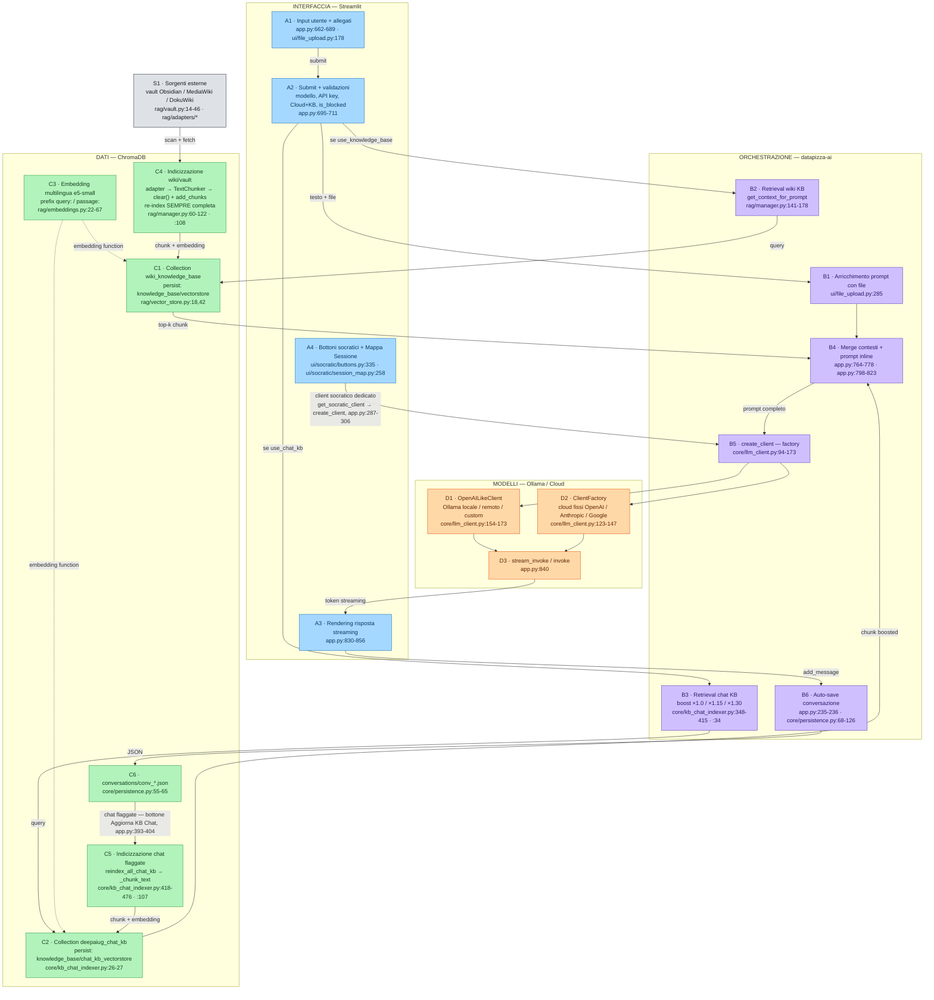

# Diagramma A — Flusso dati (DeepAiUG Interface v1.15.2)

> Fallback Mermaid verificabile del file
> `DeepAiUG_Architettura-Flusso_Dati-v1_15_2.excalidraw`.
> Importabile direttamente nella canvas Excalidraw se il JSON avesse problemi.
> Ogni nodo è tracciabile a `file:riga` (inventario Fase 1, v1.15.2).

## Legenda

| Layer | strokeColor | backgroundColor |
|---|---|---|
| Interfaccia (Streamlit) | `#1971c2` | `#a5d8ff` |
| Orchestrazione | `#5f3dc4` | `#d0bfff` |
| Dati / ChromaDB | `#2f9e44` | `#b2f2bb` |
| Modelli / Ollama | `#e8590c` | `#ffd8a8` |
| Esterno / non fidato (S1) | `#343a40` | `#dee2e6` |

- **Freccia continua** = flusso della richiesta/dati. **Freccia tratteggiata** = dipendenza/uso.
- **S1** è lo stesso oggetto del nodo X6 del Diagramma B (sorgenti wiki/vault),
  visto dall'angolazione del flusso dati anziché della superficie di rete.
- `build_rag_prompt` (`core/conversation.py:103-143`) esiste ma **non è raggiunta** dal
  percorso di submit: il prompt è costruito inline in `app.py:798-823` (nodo B4).
- L'indicizzazione wiki/vault è **sempre completa**: `vector_store.clear()` in
  `rag/manager.py:108` precede `add_chunks`. `get_files_to_update`
  (`rag/vault.py:67-75`) è definita ma senza call site.
- Il boost per rilevanza (×1.0/×1.15/×1.30, `core/kb_chat_indexer.py:34`) esiste
  **solo** sulla collection chat, non sulla wiki KB.
- Il client socratico (A4) passa da `create_client` (`app.py:296`) e quindi dal
  check `is_blocked` (`core/llm_client.py:151/:164`): stesso choke point della chat.
- C6 → C5 → C2 chiude il ciclo epistemico: le conversazioni salvate e flaggate
  rientrano nel retrieval come knowledge base.
