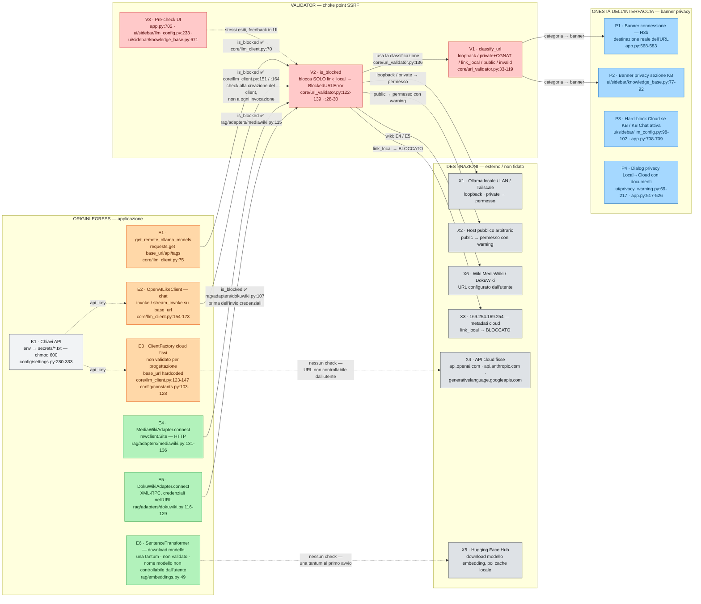

# Diagramma B — Superficie di rete e sicurezza (DeepAiUG Interface v1.15.2)

> Fallback Mermaid verificabile del file
> `DeepAiUG_Architettura-Sicurezza_Egress-v1_15_2.excalidraw`.
> Importabile direttamente nella canvas Excalidraw se il JSON avesse problemi.
> Mostra la **superficie di egress reale** (inclusi i punti non validati),
> non solo quella coperta dall'audit v1.15.2.

## Legenda

| Layer | strokeColor | backgroundColor |
|---|---|---|
| Origini layer Modelli (E1-E3) | `#e8590c` | `#ffd8a8` |
| Origini layer Dati/adapter (E4-E6) | `#2f9e44` | `#b2f2bb` |
| Sicurezza / validator (V1-V3) | `#c92a2a` | `#ffc9c9` |
| Esterno / non fidato (X1-X6) | `#343a40` | `#dee2e6` |
| Credenziali locali (K1) — file 0600, non "esterno" | `#343a40` | `#f1f3f5` |
| Interfaccia / banner (P1-P4) | `#1971c2` | `#a5d8ff` |

- **Freccia continua** = egress che passa dal validator (`is_blocked`), con la riga
  del check in etichetta. **Freccia tratteggiata** = egress non validato (con
  motivazione) oppure dipendenza (chiavi API, pre-check UI).
- **V2 → V1**: `is_blocked` delega a `classify_url`
  (`core/url_validator.py:136`) — il choke point è unico perché la
  classificazione è centralizzata.
- **E2**: il check avviene **alla creazione del client**, non a ogni
  invocazione (`create_client`, `core/llm_client.py:151/:164`). Vale anche per
  il client socratico, creato via `get_socratic_client → create_client`
  (`app.py:296`).
- **E3** e **E6** sono egress **reali ma non validati**: E3 per progettazione
  (base_url hardcoded, il check H1c copre solo il provider "Custom"); E6 è il
  download una tantum del modello di embedding da Hugging Face Hub (nome
  modello hardcoded, override solo via env `DEEPAIUG_EMBEDDING_MODEL`).
- **P3 / P4** sono blocchi applicativi (privacy-first), senza archi di rete.
- Limiti noti del validator (rischio accettato, `SECURITY_AUDIT_RESOLUTION.md`):
  validazione al momento del check (no difesa DNS-rebinding/TOCTOU), risoluzione
  solo IPv4.
- `subprocess ollama list` (`core/llm_client.py:27`) è un processo locale, non
  egress di rete: escluso dal diagramma.
